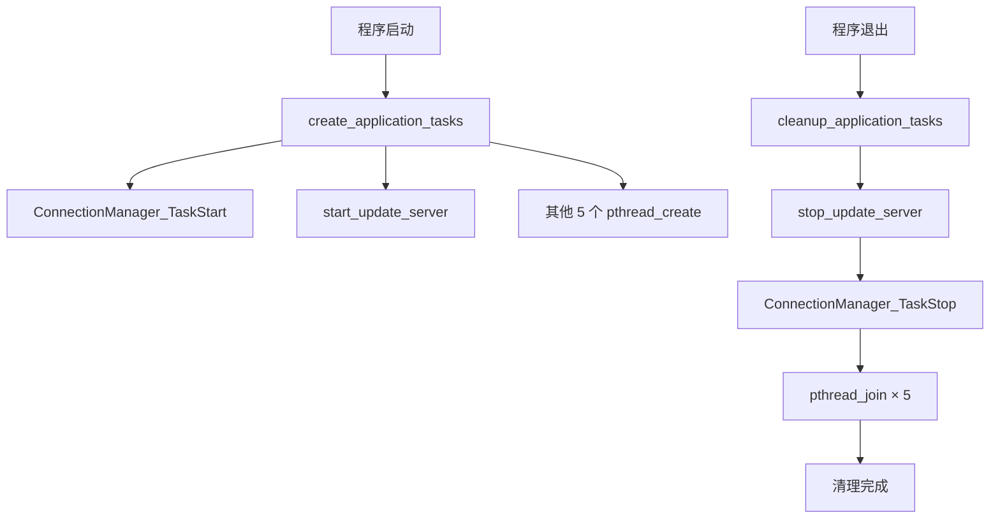

# 线程资源清理使用指南

## 概述

本文档说明如何正确调用系统中所有线程的清理函数，确保资源安全释放。

## 系统线程架构

系统共包含 **7 个线程**：

### 通过 pthread_create 创建的线程（5 个）
1. **配置任务管理器** (ConfigTaskManager) - threads[0]
2. **UDP 搜索任务** (UdpSearchTask) - threads[1]
3. **报告管理任务** (ReportManagerTask) - threads[2]
4. **实时调度任务** (RealTimeSchedulerTask) - threads[3]
5. **按键处理任务** (KeyProcessTask) - threads[4]

### 独立管理的线程（2 个）
6. **连接管理器** (ConnectionManagerTask) - 由 `ConnectionManager_TaskStart/Stop` 管理
7. **固件更新服务器** (update_server_main) - 由 `start_update_server/stop_update_server` 管理

## 清理函数接口

### 统一清理入口（推荐使用）

```c
#include "app_init_modules.h"

// 在程序退出时调用此函数即可
void cleanup_application_tasks(void);
```

**功能说明：**
- 自动按正确顺序停止所有 7 个线程
- 包含完整的错误处理和日志输出
- 遵循依赖关系逆序清理原则

**调用位置示例：**

```c
// app_init.c - 主入口函数
void app_start(void) 
{
    // ... 初始化代码 ...
    
    ret = create_application_tasks();
    if (ret == OK)
    {
        LOG_INFO("Application tasks created successfully.\n");
    }
    else
    {
        LOG_ERROR("Failed to create application tasks.\n");
        cleanup_application_tasks();  // 失败时立即清理
        return;
    }

    // 程序主循环或等待
    // ... 主循环代码 ...

    // 程序正常退出前回收所有线程资源
    LOG_INFO("Application is exiting, cleaning up threads...\n");
    cleanup_application_tasks();
}
```

### 独立清理函数（特殊场景使用）

#### 1. 停止固件更新服务器

```c
#include "app_com.h"

STATUS stop_update_server(void);
```

**使用场景：**
- 需要单独关闭固件更新服务
- 动态重新配置升级服务
- 测试环境中的独立控制

**示例：**
```c
// 单独停止固件更新服务器
if (need_stop_firmware_server) {
    stop_update_server();
}
```

#### 2. 停止连接管理器

```c
#include "app_net_con.h"

STATUS ConnectionManager_TaskStop(void);
```

**使用场景：**
- 网络模块热插拔
- 动态重配网络连接
- 故障恢复场景

**示例：**
```c
// 单独停止连接管理器
if (network_reconfig_needed) {
    ConnectionManager_TaskStop();
    // 重新配置后再次启动
    ConnectionManager_TaskStart();
}
```

## 完整调用流程图



## 信号处理示例（优雅退出）

如果需要支持 Ctrl+C 或其他信号触发优雅退出，可添加信号处理：

```c
#include <signal.h>
#include <stdlib.h>
#include "app_init_modules.h"

static void signal_handler(int signum)
{
    LOG_INFO("\n收到退出信号 %d，正在清理资源...\n", signum);
    cleanup_application_tasks();
    exit(0);
}

// 在 main 函数中注册信号处理
int main(void)
{
    // 注册信号处理器
    signal(SIGINT, signal_handler);   // Ctrl+C
    signal(SIGTERM, signal_handler);  // kill 命令
    
    // 启动应用
    app_start();
    
    return 0;
}
```

## 注意事项

### ✅ 正确做法
1. **优先使用统一清理入口** - `cleanup_application_tasks()` 已包含所有必要的清理步骤
2. **遵循调用顺序** - 统一清理函数已按正确顺序调用，无需手动调整
3. **检查返回值** - 在独立调用停止函数时应检查返回值

### ❌ 错误做法
1. **不要重复调用** - 避免同时调用统一清理和独立停止函数
2. **不要跳过清理** - 即使在异常退出路径也应调用清理函数
3. **不要直接 kill 线程** - 必须使用pthread_join 等待线程正常退出

## 调试信息

清理函数会输出详细日志，便于追踪线程回收过程：

```
Cleaning up application tasks...
[*] 正在停止固件更新服务器 (线程 ID: 140234567890)...
[+] 固件更新服务器已停止并回收资源
ConnectionManager: Stopping thread (ID: 140234567891)...
ConnectionManager: Thread stopped and resources cleaned up.
Thread 0 joined successfully
Thread 1 joined successfully
Thread 2 joined successfully
Thread 3 joined successfully
Thread 4 joined successfully
All application tasks cleaned up.
```

## 相关头文件

```c
// 统一清理接口
#include "app_init_modules.h"     // cleanup_application_tasks()

// 独立停止接口
#include "app_com.h"              // stop_update_server()
#include "app_net_con.h"          // ConnectionManager_TaskStop()
```

## 参考文档

- POSIX 线程编程最佳实践
- 嵌入式 Linux 多线程资源管理指南
- 项目架构设计文档
